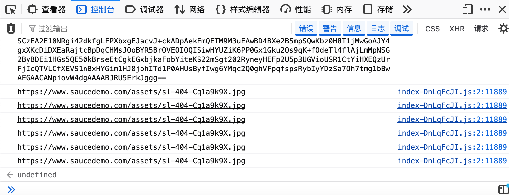
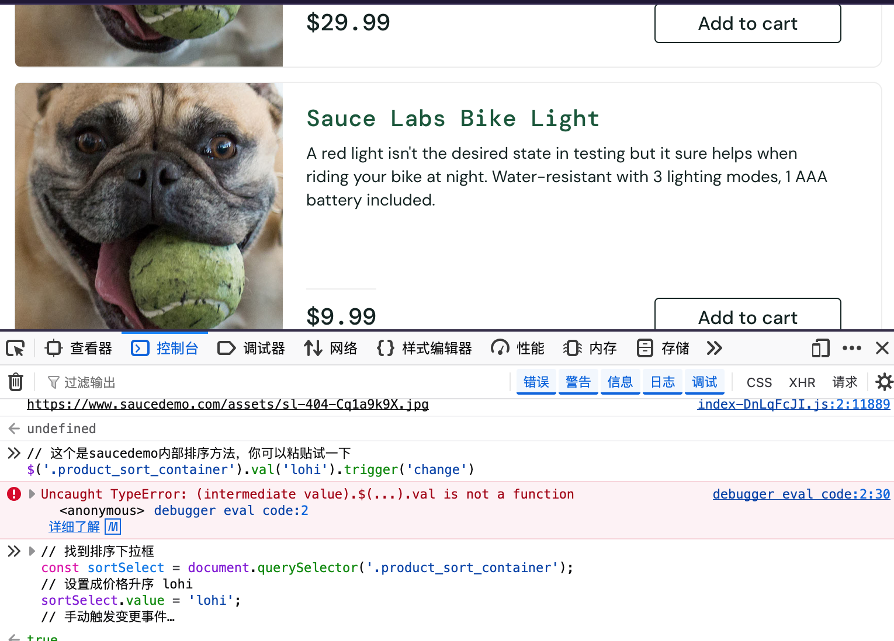
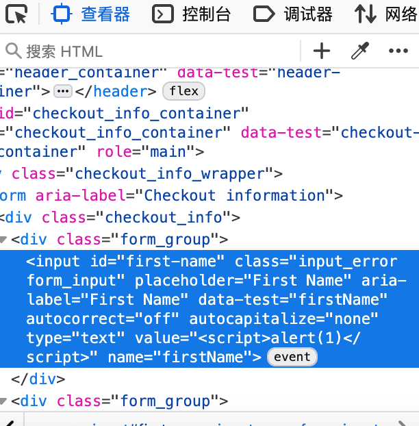

# Web & API 自动化测试实战演示 (Web & API Test Demo)

本项目用于展示个人在软件测试领域的实战能力，包含 **UI 功能测试** 与 **接口自动化测试** 两个核心模块，涵盖了从用例设计、缺陷管理到自动化脚本编写及报告生成的完整闭环。

## 📁 目录结构
```text
web-api-test-demo/
├── README.md 
├── SwagLabs 电商实验网站项目测试/ # UI 功能测试实战项目
│   ├── 项目测试用例表.xlsx     # 全量测试资产汇总 (包含：项目说明、测试用例、Bug缺陷、体验优化四张表)
│   ├── 测试用例表.csv          # 专为 GitHub 预览拆分的用例表
│   ├── bug缺陷.csv             # 专为 GitHub 预览拆分的缺陷记录
│   ├── 体验优化.csv            # 专为 GitHub 预览拆分的优化建议
│   └── bug截图/               # 执行测试过程中发现的bug缺陷截图
│                              # 命名示例："BUG-001_购物车为空_可正常结算下单.png"
│
└── api_test_project/          # 接口自动化测试项目
    ├── test_api.py            # Pytest 自动化测试脚本
    ├── report.html            # HTML 测试报告 (下载后可浏览器打开)
    ├── assets/                # 报告所需的静态资源文件
    └── readme_images/         # 供 README 展示用的截图
        ├── code_screenshot.png    # 自动化代码截图
        └── report_screenshot.png  # 测试报告截图
```
🛒 模块一：UI 功能测试 (UI Test)

    测试对象：Swag Labs 电商演示网站

    测试内容：用户登录、商品浏览、购物车管理、订单结算等核心业务流。

    交付成果：

        全量测试资产：包含完整的 项目测试用例表.xlsx（内含项目说明、测试用例、Bug缺陷、体验优化四大维度）。

        在线文档预览：为了方便在 GitHub 上直接查看，已将核心数据特别转换为 CSV 格式（见下方）。

        缺陷追踪的截图合集：精准定位前端 UI 与业务逻辑缺陷，并按规范命名截图提交。

📊 测试文档在线预览 (点击直达)

(注：为了提供更好的在线预览体验，以下数据已从原 Excel 中提取并转换为 GitHub 原生支持的 CSV 格式。
但内容和格式完整的表格，请下载完整表格”项目测试用例表.xlsx “    内含：项目说明、测试用例、Bug缺陷、体验优化四张表)

    👉 [测试用例清单 (测试用例表.csv)](./SwagLabs电商实验网站项目测试/测试用例表.csv) - 涵盖正向流程、异常边界与权限校验。

    👉 [**Bug 缺陷汇总 (bug缺陷.csv)](./SwagLabs电商实验网站项目测试/bug缺陷.csv) - 记录测试执行中发现的严重及一般缺陷。

    👉 [**体验优化建议 (体验优化.csv)](./SwagLabs电商实验网站项目测试/体验优化.csv) - 基于用户视角的 UI/UX 改进建议。

🐛 缺陷截图演示 (Bug Screenshot)





    注：更多详细缺陷截图请查看 SwagLabs电商实验网站项目测试/bug截图 文件夹。

🚀 模块二：接口自动化测试 (API Test)

    测试对象：一言 API (https://v1.hitokoto.cn/)

    技术栈：Python + Requests + Pytest

    项目亮点：

        数据驱动：使用 @pytest.mark.parametrize 实现数据与代码分离，单脚本自动遍历正向（200）与异常（404）场景。

        多层断言：不仅校验 HTTP 状态码，还深入校验 JSON 响应体中的业务字段（hitokoto）是否存在且非空。

        可视化报告：集成 pytest-html 插件，自动生成直观的 HTML 测试报告。

💻 自动化代码展示

https://./api_test_project/readme_images/code_screenshot.png

    说明：通过参数化数据驱动，验证接口在不同输入下的返回状态。

📈 测试报告展示

https://./api_test_project/readme_images/report_screenshot.png

    说明：执行 pytest test_api.py --html=report.html 后生成的报告，成功通过了正向与异常共 2 条用例。

💡 如何查看完整测试报告？
请在本地下载 api_test_project 文件夹，双击 report.html 即可在浏览器中查看完整的测试结果与执行耗时。

🧑‍💻 关于我

具备扎实的软件测试基础，熟练运用测试用例设计方法（等价类、边界值等）进行 UI 测试，熟练使用f12开发者工具和利用无痕模式控制变量，查日志，多维度对比印证等方式帮助定位根因。
熟悉接口测试流程与自动化闭环，不仅能够独立使用 Python/Pytest 编写自动化脚本，使用postman软件。
并能妥善利用 Git 管理测试资产与代码。
擅长使用ai辅助完善工作，提高效率，同时可以人工校验ai的查缺补漏面对真实场景能否落地，不是无脑信任使用，成为最后一道防线。

    GitHub: @juxiayou
