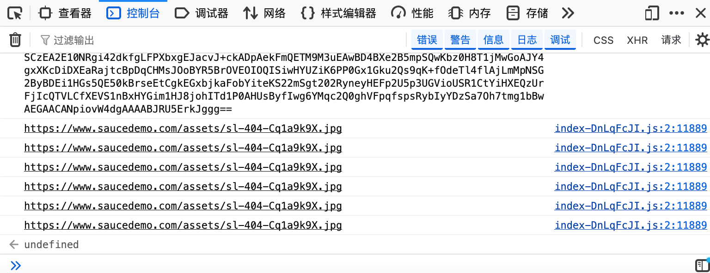
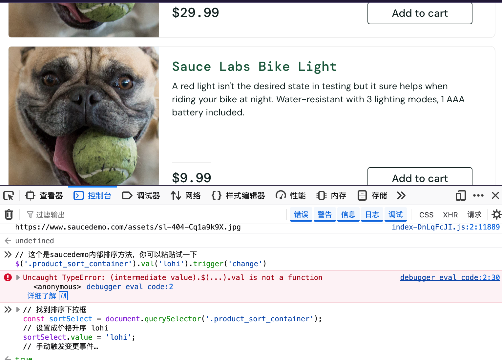
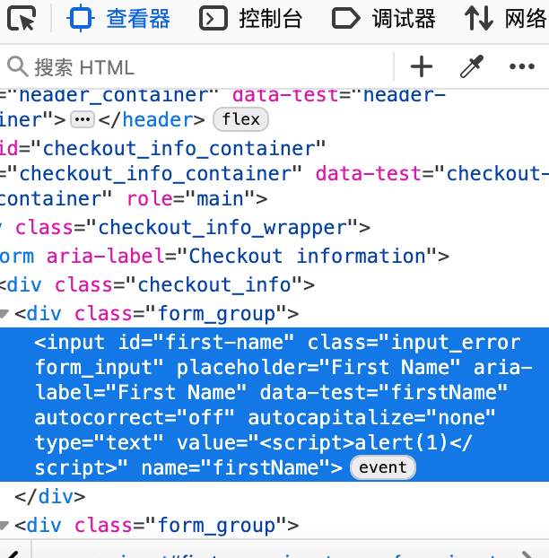
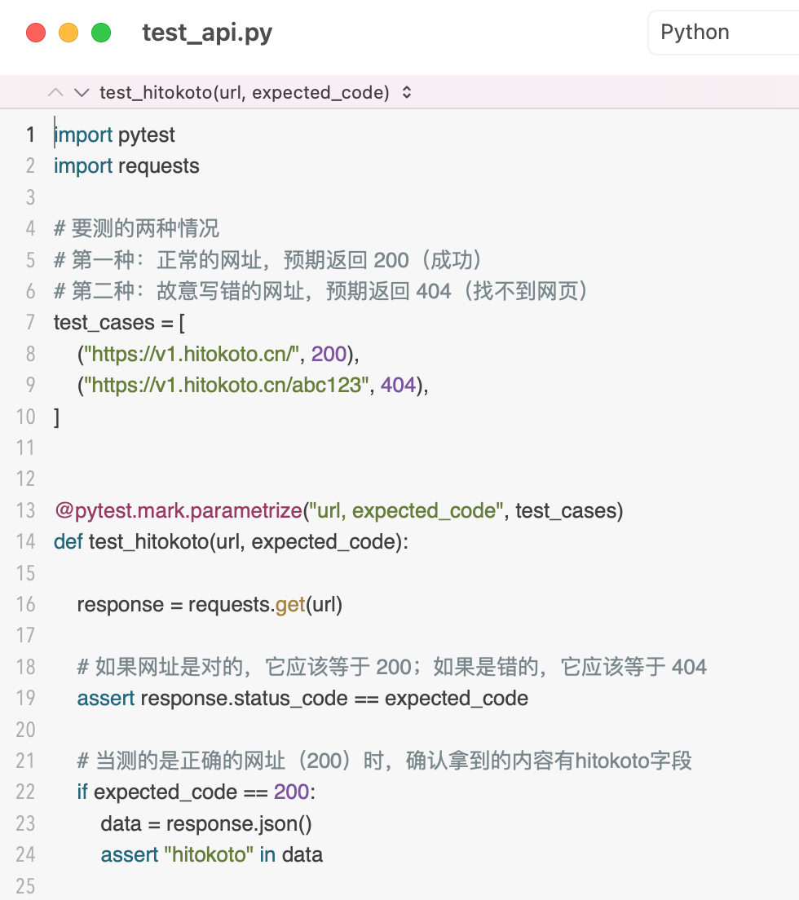
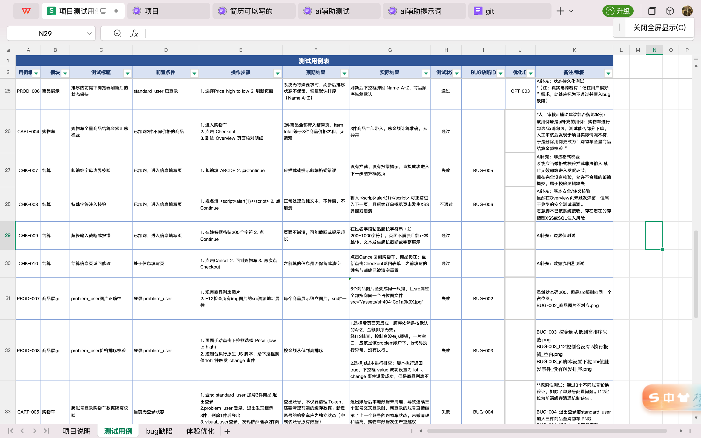

# Web & API 自动化测试实战演示 (Web & API Test Demo)

本项目用于展示个人在软件测试领域的实战能力，包含 **功能测试**、**接口自动化测试** 以及 **JMeter 接口与性能测试学习笔记** 三个核心模块，前两个涵盖了从用例设计、缺陷管理到自动化脚本编写及报告生成的完整流程。

## 📁 仓库目录结构

```text
web-api-test-demo/
├── README.md                         # 仓库说明文件
│
├── SwagLabs电商实验网站项目测试/      # UI 功能测试实战项目
│   ├── 项目测试用例表.xlsx           # 全量测试资产汇总 (含项目说明、用例、Bug、优化建议)
│   ├── 测试用例表.csv                # 专为 GitHub 预览拆分的用例表
│   ├── bug缺陷.csv                   # 专为 GitHub 预览拆分的缺陷记录
│   ├── 体验优化.csv                  # 专为 GitHub 预览拆分的优化建议
│   └── bug截图/                      # 执行测试过程中发现的 bug 截图
│                                     # 命名示例："BUG-001_购物车为空_可正常结算下单.png"
│
├── api_test_project/                 # 接口自动化测试项目 (Python + Pytest)
│   ├── api_test_ReqRes/              # 分层接口自动化实战（登录拿 Token + 增删改查）
│   │     ├── conftest.py             # 公共配置：fixture夹具、基础地址、登录Token、请求会话
│   │     ├── api/                    # 接口封装层：把所有接口的请求逻辑封装成方法
│   │     │   └── reqres_api.py
│   │     └── testcases/              # 测试用例层：只写测试步骤+断言，不写重复请求代码
│   │          ├── test_login.py       # 登录接口测试用例
│   │          └── test_user_crud.py   # 用户增删改查测试用例（依赖登录Token）
│   │
│   ├── test_api.py                   # Pytest 自动化测试脚本（一言接口基础练习）
│   ├── report.html                   # HTML 测试报告 (下载后可浏览器打开)
│   ├── assets/                       # 报告所需的静态资源文件
│   └── readme_images/                # 供 README 展示用的截图
│       ├── code_screenshot.png       # 自动化代码截图
│       └── report_screenshot.png     # 测试报告截图
│
└── jmeter_test/                      # JMeter 接口与性能测试学习笔记
    ├── jmeter_note.md                # 核心学习笔记 (组件作用域、关联、断言等)
    ├── images/                       # 笔记中引用的窗口截图图片
    └── jmeter训练截图/               # 实操界面截图记录
```

## 🛒 模块一：UI 功能测试 (UI Test)

- **测试对象**：Swag Labs 电商演示网站
- **测试内容**：用户登录、商品浏览、购物车管理、订单结算等核心业务流。
- **交付成果**：
  - **全量测试资产**：包含完整的 `项目测试用例表.xlsx`（内含项目说明、测试用例、Bug缺陷、体验优化四大维度）。
  - **在线文档预览**：为了方便在 GitHub 上直接查看，已将核心数据特别转换为 CSV 格式（见下方）。
  - **缺陷追踪的截图合集**：精准定位前端 UI 与业务逻辑缺陷，并按规范命名截图提交。

### 📊 测试文档在线预览 (点击直达)

*(注：为了提供更好的在线预览体验，以下数据已从原 Excel 中提取并转换为 GitHub 原生支持的 CSV 格式。但内容和格式完整的表格，请下载完整表格 `项目测试用例表.xlsx` 内含：项目说明、测试用例、Bug缺陷、体验优化四张表)*

- 👉 [**测试用例清单 (测试用例表.csv)**](./SwagLabs电商实验网站项目测试/测试用例表.csv) - 涵盖正向流程、异常边界与权限校验。
- 👉 [**Bug 缺陷汇总 (bug缺陷.csv)**](./SwagLabs电商实验网站项目测试/bug缺陷.csv) - 记录测试执行中发现的严重及一般缺陷。
- 👉 [**体验优化建议 (体验优化.csv)**](./SwagLabs电商实验网站项目测试/体验优化.csv) - 基于用户视角的 UI/UX 改进建议。

### 🐛 缺陷截图演示 (Bug Screenshot)





> *注：更多详细缺陷截图请查看 `SwagLabs电商实验网站项目测试/bug截图` 文件夹。*

---

## 🚀 模块二：接口自动化测试 (API Test)

### 2.1 ReqRes 用户管理接口自动化（分层实战）

- **测试对象**：ReqRes 公开练习接口，业务流是「登录拿 Token → 带 Token 查询、新增、更新、删除用户」
- **代码位置**：`api_test_project/api_test_ReqRes/`
- **技术栈**：Python + Requests + Pytest + pytest-html + Git

**框架怎么分的层**

| 文件 | 放什么 | 为什么要单独拆出来 |
| --- | --- | --- |
| `conftest.py` | fixture：基础地址、`requests.Session` 会话、登录 Token | 登录只做一次，Token 存进会话请求头，所有用例自动带上；环境地址也只改一处 |
| `api/reqres_api.py` | 接口封装类，一个接口一个方法 | 接口地址、入参变了只改这里，用例不用跟着改 |
| `testcases/` | 测试场景 + 断言 | 只关心测什么、预期是什么，读起来干净 |

**用例覆盖**

- 登录：正确账号密码 → 返回 Token；不传密码 → 400 和对应错误提示
- 查询：带分页参数查用户列表，校验页码、数据条数、字段是否存在
- 新增：201，校验返回的 name、job 与传入一致，且有 id、createdAt
- 更新：200，校验修改后的字段生效
- 删除：204

**断言写法**：不只看状态码，还会校验响应 JSON 里的业务字段和数据结构，避免接口通了但数据不对。

**执行命令**

```bash
cd api_test_project/api_test_ReqRes
pytest testcases/ --html=report.html --self-contained-html
```

> 说明：ReqRes 是境外公开练习服务，国内网络时不时连不上，或者返回的不是 JSON（直接报 `JSONDecodeError`）。这是网络层面的问题，不是脚本问题；把 `base_url` 换成自己能访问的服务，整套框架可以原样复用。

### 2.2 一言 API 基础练习

- **测试对象**：一言 API (https://v1.hitokoto.cn/)
- **技术栈**：Python + Requests + Pytest
- **脚本位置**：`api_test_project/test_api.py`
- **项目亮点**：
  - **参数化**：用 `@pytest.mark.parametrize` 把 URL 和预期状态码放进列表，一个函数自动跑正向（200）和异常（404）两种情况。
  - **多层断言**：除了状态码，还解析 `response.json()` 校验业务字段 `hitokoto` 是否存在。
  - **可视化报告**：集成 `pytest-html`，生成 HTML 报告。

### 💻 自动化代码展示



> *说明：一言接口的参数化脚本截图，一个测试函数覆盖两种输入。*

### 📈 测试报告展示



> *说明：执行 `pytest test_api.py --html=report.html` 后生成的报告，正向与异常共 2 条用例通过。*

💡 **如何查看完整测试报告？**
请在本地下载 `api_test_project` 文件夹，双击 `report.html` 即可在浏览器中查看完整的测试结果与执行耗时。

---

## 🧑‍💻 关于我

具备扎实的软件测试基础，熟练运用测试用例设计方法（等价类、边界值等）做 UI 测试。查问题时习惯用 F12 开发者工具配合无痕模式控制变量，看日志、对比前后表现，尽量把根因定位到前端还是后端。
接口测试方面，熟悉完整流程和自动化写法：能独立用 Python/Pytest 写脚本，也能用 Postman、JMeter 调试接口；做过分层框架，用 fixture 管公共前置和 Token，接口逻辑和用例分开写。
平时用 Git 管理测试资产和代码。
主流程的测试框架设计，核心功能、重要功能等，都先人工拆出核心测试用例后，会用 AI 辅助对此查缺补漏，并提非核心和重要的功能测试点、补用例，但结果都会人工过一遍，AI 编出来的功能会删掉，不会照搬。

- **GitHub**: [@juxiayou](https://github.com/juxiayou)

---