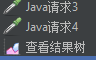
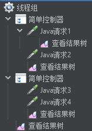
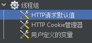
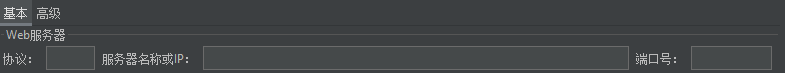
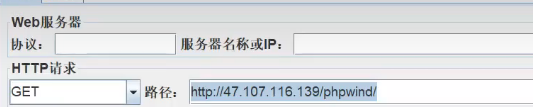
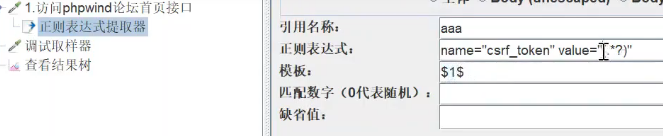
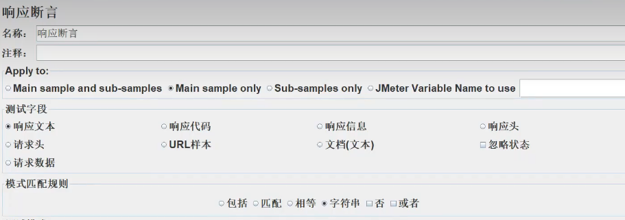

# JMeter 接口测试学习笔记

## 一、接口测试基础

1. **为什么要做接口测试？**
   - **前后端分离**：后端负责开发接口，前端调用。必须先测试接口，之后才进行功能测试。
   - **项目交互**：项目通常不是孤立的，经常要调用外部项目。例如：保险行业有50个项目，承接和核算两个项目之间通过接口交互数据。
   - **安全考虑**：必须要有健全的接口鉴权，否则外部可以直接攻击后台接口。

2. **接口测试测什么？**
   - 接口本质上就是一个函数（例：USB接口），测试维度包括：
     - 参数：数据传递的正确性，是否会发生数据错误、数据丢失。
     - 输出结果的正确性。
     - 容错的处理。
     - 权限控制。
   - 总结项目接口核心测试点：**参数、结果、容错处理、异常、权限**。

3. **常用的接口测试工具？**
   - JMeter、Postman、Apipost

4. **接口测试流程**
   - **第一步**：拿到 API 接口文档，熟悉接口业务、地址、鉴权、端口、入参、出参和错误码。
   - **第二步**：编写接口测试用例以及评审。
     - **正例**：输入正常的参数，验证接口能够正常返回。（注：如果内部接口只对内开放，可以只测正例）。
     - **反例 - 鉴权异常**：Token 为空、错误、过期。
     - **反例 - 参数异常**：为空、长度异常、类型异常、其他业务异常。
     - **反例 - 其他异常**：是否有黑名单、调用次数限制、分页场景。
     - **反例 - 兼容异常**：一个接口被多端调用，版本的兼容。

---

## 二、JMeter 组件与作用域详解

**1. 核心 10 大组件（元件）**
- **测试计划 (Test Plan)**：容器。
- **线程组 (Thread Group)**：相当于用户，设置 1-N 个并发用户。
- **配置元件 (Config Element)**：接口配置，如协议、接口服务器 IP、端口。
- **前置处理器 (Pre Processor)**：在接口请求之前的操作。
- **逻辑控制器 (Logic Controller)**：判断条件成立才请求接口，或循环请求。
- **定时器 (Timer)**：延迟请求接口。
- **取样器 (Sampler)**：最小单元，真正用来发送请求的组件。
- **后置处理器 (Post Processor)**：在接口请求之后的操作（常用于提取返回值）。
- **断言 (Assertions)**：判断接口是否成功。
- **监听器 (Listener)**：收集测试结果，生成报告。

**2. 组件的作用域（非常重要！）**
- **结论一**：组件可以作用于父组件。如果想作用于一个组件，就放到该组件下面（子节点）。
  -  
- **结论二**：组件可以作用于兄弟组件。如果想作用于多个组件，放到它们的平级。
  - 
- **结论三**：组件可以作用于平级兄弟组件之下的所有子组件。
  - 

---

## 三、JMeter 接口测试实战

### 场景一：单人负责所有接口（规模不大）
- 
  
**1. 请求构造**
- **请求方式**：GET, POST 等。
- **请求路径**：接口 URL。
- **请求参数**：
  - 查询字符串参数：直接在路径后面用 `?` 传，多个参数用 `&` 隔开。
  - JSON 参数：在消息体（Body Data）中传。
  - 文件参数：文件上传。
- **请求头**：配置 Content-Type、Token 等信息。
- **响应**：通过监听器查看结果树。

**2. 接口关联（下一个接口需要用到上一个接口的返回值）**
- **注意**：`access_token` 每次登录会改变，下一个接口需要用到它，这就是接口关联。
- **方案一：JSONPath 实现接口关联**（需要用到后置处理器中的 JSON 提取器）
  - 
    
  - 表达式写法：`$` 代表根节点，`.` 取子节点。
  - 第一个接口中使用 `$.access_token` 提取。
  - 下一个接口中使用 `${access_token}` 取值。
  
  - *注意*：如果在路径中填写完整路径，则默认值不会生效。
  
- **方案二：正则表达式实现接口关联**（正则提取器）
  - 
  - 表达式写法：`左边界(.*?)右边界` （左右边界必须唯一）。
    

### 场景二：多人协同测试（负责多个模块）
涉及到团队协同问题，使用**测试片段**。

**1. 什么是测试片段 (Test Fragment)？**
- 相当于项目的一部分用例，**不能单独运行**，必须要和控制器（Include Controller、模块控制器）一起使用才能执行。
- 默认是禁用状态。

**2. 如何使用测试片段？（组员视角）**
- 新建一个测试片段，把该模块所有的组件都放到这个测试片段下面。
- 通过线程组下面的模块控制器（Module Controller）去控制这个片段的执行和结果查看。

**3. 如何协同？**
- **组员**：启用测试模块，保存为测试片段，然后发给组长（通过 SVN 或 Git 等版本控制工具）。
- **组长**：新建一个线程组，然后新建 Include 控制器去调用收到的 `.jmx` 文件。

---

## 四、接口测试断言

**1. 常用断言分类**
- **响应断言 (Response Assertion)**：最常用。
  - 
  - `包括` 和 `字符串` 的意思一样，但是 `包括` 能够支持正则表达式。
  - `匹配` 和 `相等` 也是一样，`匹配` 支持正则表达式。
    
  
- **JSON 断言 (JSON Assertion)**：使用 JSON 表达式获取节点，并可以进行对比数值。
- **Beanshell 断言**：需要了解 Beanshell 语言，目前市面 95% 以上不用，主要用来解决极复杂的场景（暂不深入学习）。